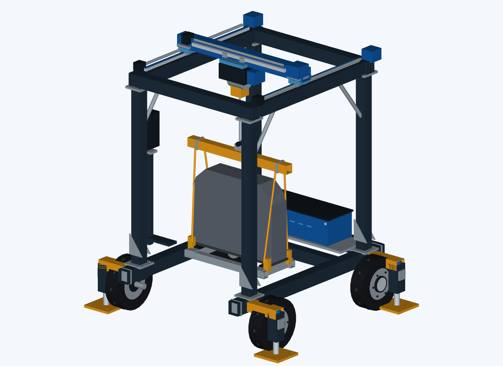
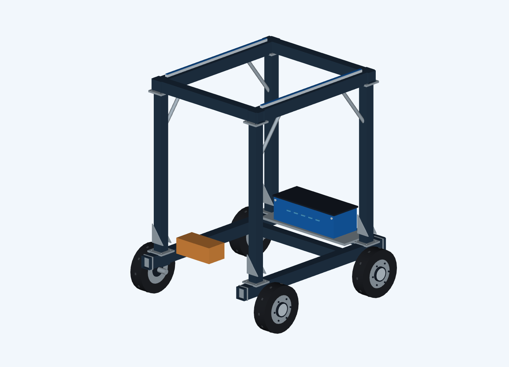
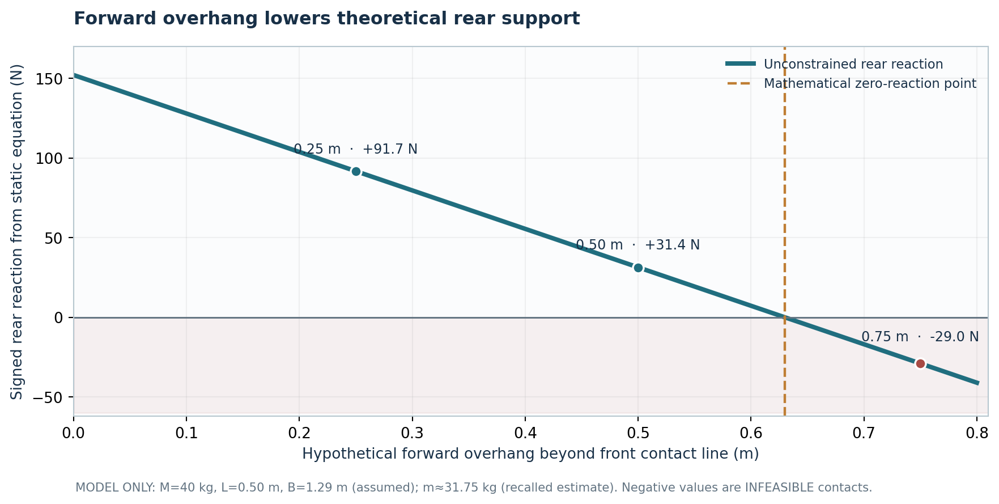

# RoverSetter

**Independent mechanical engineering project | Mobile monument handling · CAD · Longitudinal stability**

[](https://github.com/matthewvillegas/RoverSetter/actions/workflows/python-tests.yml)

RoverSetter began with a problem I encountered while installing cemetery monuments: a difficult installation took approximately **three to four hours**, and a stone was damaged during handling. I began developing a compact, maneuverable mobile system to improve transport and positioning. The original design ambition was to handle monuments weighing up to **2,000 lb**; that capacity **was never demonstrated or certified**.



*Current export of the RoverSetter CAD design. This is a design view—not a photograph of a finished or load-rated physical machine.*

## Project at a glance

| Stage | Work and evidence |
| --- | --- |
| Real-world problem | Difficult monument transport and positioning in a cemetery setting |
| Physical development | **Three prototype iterations**, as recalled by the designer; the hardware is no longer available |
| Prototype 3 observation | Approximately **70 lb** suspended stone; near-simultaneous rear-wheel lift at rest; increased pitching during drive startup |
| Engineering investigation | Idealized static equilibrium, load-overhang sensitivity, numerical calculations and unit tests |
| Outcome | Identified why greater forward load offset reduces **theoretical** rear support; historical motor-startup cause unresolved |

## Three prototype iterations

1. **Prototype 1 — initial mechanical proof of concept.** Built to explore the handling problem. Contemporary technical details have not been recovered.
2. **Prototype 2 — mechanical revision.** Revised after the first concept was unsatisfactory. Exact changes between the two builds remain insufficiently documented.
3. **Prototype 3 — integrated system.** Combined motorized chassis movement with a forward hoist/positioning concept. A smaller-stone test revealed pitching instability.

These build descriptions reflect firsthand recollection. The physical prototypes are no longer available, and this repository does not claim that CAD renders independently prove their construction. More detail is in [HISTORY.md](HISTORY.md).

## Prototype 3: what I observed

During a test on a hard surface, an approximately **70 lb** stone, recalled as **16 × 8 × 6 inches**, was suspended beyond the front wheel-support line. With the chassis supported on its wheels, both rear wheels rose nearly together and the machine rocked and settled. Immediately when the drive motors accelerated the chassis forward, pitching became more pronounced.



*Prototype 3 CAD design view with the recalled stone dimensions. The image does not document the measured hoist attachment point or stone position during the original test.*

The original hook position, machine center of mass, load-overhang distance, motor torques, and time-resolved wheel forces were not retained. **The original failure's exact cause has not been established.**

## Longitudinal stability investigation

Taking moments about the **front wheel line** gives a simplified, stationary, level-ground model for the total rear-support reaction:

$$
N_{\mathrm{rear}}=\frac{MgL-mgd}{B}
$$

Where `M` is machine mass, `L` is the machine center-of-mass arm behind the front support, `m` is suspended load mass, `d` is forward overhang, and `B` is fore-aft support spacing. With other quantities fixed:

$$
\frac{dN_{\mathrm{rear}}}{dd}=-\frac{mg}{B}
$$

The calculated rear reaction decreases as the load is positioned farther forward. This describes **static model sensitivity**, not the original machine's proven tipping threshold.

| Hypothetical overhang | Predicted signed rear reaction |
| --- | ---: |
| 0.25 m | +91.7 N |
| 0.50 m | +31.4 N |
| 0.75 m | −29.0 N — assumed static contact infeasible |

**These numbers are theoretical calculations, not measured physical-test data.** The model uses assumed `M = 40 kg`, `L = 0.50 m`, `B = 1.29 m`, and `m ≈ 31.75 kg` based on the recalled ~70 lb stone. Negative signed support indicates that the assumed contact state cannot hold—it is not a physical downward reaction from the ground.



The increased forward pitching when the chassis motors started is a **separate unresolved dynamics question**; it is not established by the gravity-only model. See [engineering case study](docs/CASE_STUDY.md) and [limitations](docs/EVIDENCE_AND_LIMITATIONS.md).

## View the engineering work

- **[Two-page engineering case study (PDF)](docs/RoverSetter_Two_Page_Case_Study.pdf)** — short admissions/portfolio version.
- **[Eight-page research report (PDF)](docs/RoverSetter_Engineering_Research.pdf)** — fuller analysis and caveats.
- **[CAD design views (PDF)](docs/RoverSetter_CAD_Views.pdf)** — selected design views.
- **[Case study (Markdown)](docs/CASE_STUDY.md)** — readable directly on GitHub.
- **[Analysis source, tests, and sample data](analysis/README.md)** — reproducible hypothetical model.
- **[History and file provenance](HISTORY.md)** — physical development account, maintained exports and evidence boundaries.

## Reproduce the model

Requires **Python 3**; the computation and unit tests use only the standard library:

```bash
python -m unittest discover -s analysis/tests -v
python analysis/src/roversetter_stability.py
```

The model script generates a CSV of **illustrative scenarios**; it does not generate experimental results. GitHub Actions runs these two commands on pushes and pull requests to `main`. A passing workflow confirms computational checks, not physical validation.

## Repository contents

```text
RoverSetter/
├── README.md
├── HISTORY.md
├── docs/             Case study, engineering PDFs, evidence limits
├── images/           CAD views and explanatory statics diagrams
├── analysis/         Numerical model, tests, hypothetical CSV
├── .github/workflows/python-tests.yml   Python tests and scenario reproduction
├── FILE_MANIFEST_SHA256.txt              Snapshot checksums
└── PUBLISH.md                            Repository maintenance notes
```

The detailed CAD/STEP source files and full preservation archive are maintained **separately**, not published here as verified construction or load-rating specifications. Current CAD images are updated exports of existing models according to my design-file history; file export dates do not independently establish first creation dates.

**Safety and technical limits:** This is an educational engineering portfolio, not a lifting-system build guide or certified design. No full-scale machine, physical load rating, material strength, or operating safety is validated by these files.

## Attribution and reuse

Engineering history and physical observations are my firsthand account. The mathematical model, documentation, and digital presentation were revised and maintained over time. No open-source license is granted; please ask before redistributing or reusing design materials.
