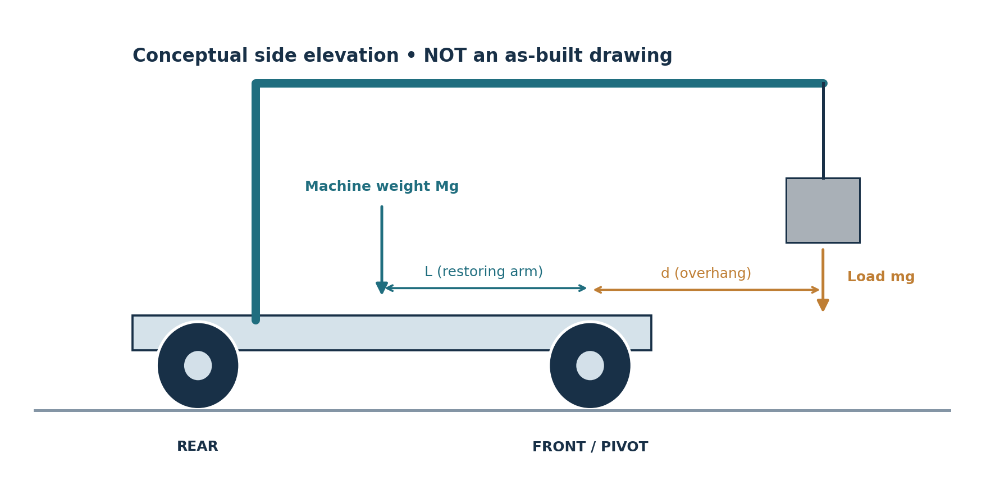

# RoverSetter — Engineering Case Study

**Mobile monument handling: three prototypes and a longitudinal stability investigation**

*RoverSetter CAD design, current export.*

## The problem

A cemetery monument installation through my business took roughly three to four hours, and the stone was damaged during handling. I started RoverSetter to explore a smaller machine for monument transport and positioning, particularly where access and terrain make conventional equipment difficult to use. The long-term design target was 2,000 lb.

## Prototype development

I built an initial mechanical concept, revised its layout in a second iteration, and integrated motorized chassis movement with forward load positioning in Prototype 3. The first two versions helped me work through the mechanism, but I do not have a complete record of their individual component changes. My clearest retained test account is from the third build.

## Prototype 3 test

I tested the machine on hard ground with a stone weighing approximately 70 lb. The stone was roughly 16 in across the chassis, 8 in front-to-back and 6 in high. It was suspended ahead of the front wheel-contact line, and the chassis was supported on its wheels.

Both rear wheels lifted almost together while stationary, and the chassis rocked before settling. When I started the drive motors and the machine accelerated forward, the pitching increased.

*CAD frame and stone geometry; the exact test overhang was not measured.*

The test did not include calibrated wheel-load measurements, motion tracking, or a measured machine center of mass. I therefore treated the physical behavior and the subsequent calculations as two separate sets of information.

## Static analysis

The machine was intended to move a suspended monument forward relative to the chassis. I had originally considered stability at a fixed load position; the follow-up investigation considered how the longitudinal reaction changes as the load advances.

Taking moments about the front wheel-contact line for a rigid stationary machine on level ground:

$$
N_{\mathrm{rear}}=\frac{MgL-mgd}{B}
$$

`M` is machine mass, `L` is its center-of-mass arm behind the front wheels, `m` is suspended load mass, `d` is forward overhang, and `B` is front-to-rear wheel-contact spacing.

The sensitivity is:

$$
\frac{dN_{\mathrm{rear}}}{dd}=-\frac{mg}{B}
$$

For a sample calculation with **assumed** machine mass 40 kg, COM arm 0.50 m, and wheelbase 1.29 m, using approximately 31.75 kg as the test-load equivalent:

| Forward overhang | Calculated rear reaction |
| --- | ---: |
| 0.25 m | +91.7 N |
| 0.50 m | +31.4 N |
| 0.75 m | −29.0 N |

*Calculated scenario results. They are not force measurements from Prototype 3.*

At 0.75 m, the signed solution is negative. That indicates the assumed four-contact static state is no longer possible; it is not an actual negative normal force.

## What I learned

A working mechanism does not guarantee a stable machine across its full range of motion. Moving a suspended load forward changes the overall moment balance even if the chassis does not move. The gravity-only model explains that trend, but it does not explain the stronger pitching I observed at motor startup.

The next meaningful step is an independently reviewed, low-risk classroom mechanics experiment comparing measured support reactions with the model's predicted trend. It would test the statics calculation, not the original heavy equipment.

**Files:** [Technical report](RoverSetter_Engineering_Research.pdf) · [CAD drawings](RoverSetter_CAD_Views.pdf) · [Engineering notes](ENGINEERING_NOTES.md) · [Python model](../analysis/README.md)
